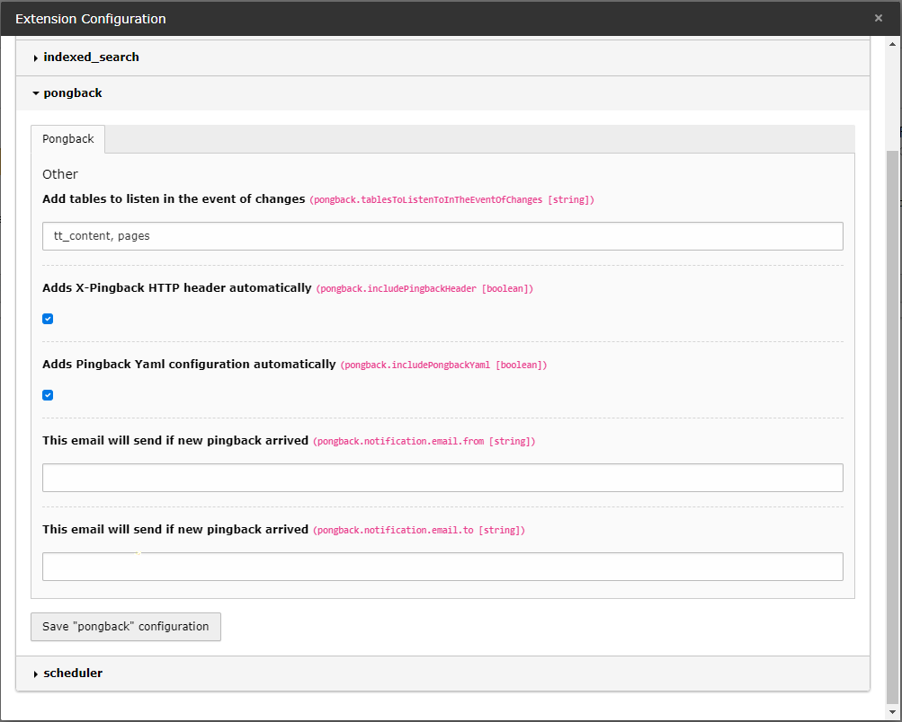

[](https://github.com/Nimmermaer/pongback/actions/workflows/ci.yml)

[TOC]

# TYPO3 Extension - Pongback

**Description**: This TYPO3 extension, developed by Webicorns, enables the sending and receiving of Pingbacks within your TYPO3 website.

## Features

- **Receiving Pingbacks**: Pongback allows your TYPO3 website to receive Pingbacks from other websites.
- **Storage and Backend Module**: It provides a backend module for storing and displaying received Pingbacks.
- **Sending Pingbacks**: You can use Pongback to send Pingbacks automatically when linking to other websites.

## Future Features

Pongback has exciting future plans to enhance its functionality:

- **Display Linked Page Pingbacks**: Pongback will display Pingbacks received on linked pages.
- **Email Notification and Backend Module**: A notification and approval process via email and the backend module will be implemented.
- **Visibility Check**: Pingbacks will only be sent if the linked page is visible.
- **Send on Page Publication**: Pingbacks will be sent only upon the publication of the linked page.
- **Latest Pingbacks Dashboard**: Pongback will introduce a dashboard feature that displays the latest Pingbacks along with their source websites.
- **Extension Compatibility**: Pongback aims to support popular TYPO3 extensions such as EXT:news and EXT:blog.

> Stay tuned for these exciting updates to Pongback!

## Quick Start

1) Install the extension:
```bash
    composer require webicorns/pongback
```

2) Configuration
    + Add the site set **"Pongback: Pingback endpoint and plugins"**
      (`webicorns/pongback`) to your site configuration. Alternatively include
      the static TypoScript template "EXT:pongback" in your TypoScript record.
    + The route enhancer for the endpoint (`pingback.ping`) is part of the site
      set (`route-enhancers.yaml`) and applied automatically in TYPO3 v14. In
      TYPO3 v13 it is added to all sites by the extension setting
      `includePongbackYaml` (enabled by default).
    + Look at the extension configuration for further configurations
      

3) Upgrading from earlier versions
    + Run the upgrade wizard "Pongback: Migrate plugins to content elements"
      to migrate existing plugins to the new content types.

## Contributing

See [CONTRIBUTING.md](CONTRIBUTING.md) for coding standards, commit message
format and quality checks.
